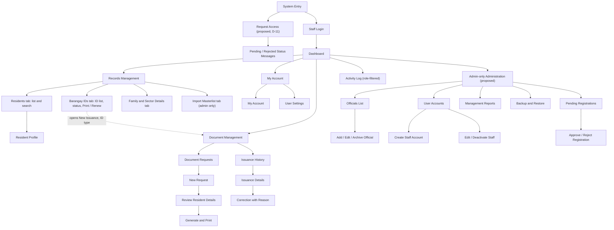

# 03 · Design and UI

Site map, navigation, page layouts, visual style and the state of the Admin portal prototype. Combines the former Site Map and Design Draft, Style Guide and Admin Portal Draft.

**Status:** design draft for group review and client validation — **not client-approved**. The prototype lives on `draft/admin-portal` and uses **fictional data**. A screen existing is not evidence that the feature works. Undecided items are tagged `(D-xx)`; see [08-Open-Decisions.md](08-Open-Decisions.md).

Last updated: November 5, 2026

## 1. Design basis

Based on the October 19–20 interviews and the final Creative Brief ([02-Requirements-and-Scope.md](02-Requirements-and-Scope.md)). The system is **staff-facing**. Do not add public resident accounts, public applications, announcements, online payments or blotter workflows without client confirmation. Never use real resident data in sample screens, commits, screenshots or demos.

## 2. Site map

This is the proposed information architecture, not a statement that every page exists. Some entries may be tabs or subviews instead of separate URLs. The Admin-only branch depends on the unresolved role model **(D-10)**.

## 3. Navigation

**Workspace:** Dashboard · Activity Log
**Records and Documents:** Records Management · Issuance Management
**User menu:** My Account (account information, Change Password) · User Settings (appearance preferences)
**Administration — System Administrator only (proposed):** Officials · User Accounts · Pending Registrations · Management Reports · Backup and Restore

Staff see only their own activity; administrators see everyone's with filters. Administrator-only routes show a friendly restricted-access screen for Staff. **That is usability, not security:** the backend must enforce every protected operation ([05-Roles-Security-and-Privacy.md](05-Roles-Security-and-Privacy.md)).

## 4. Page layout draft

### Dashboard
- Page title and short description of the system's purpose.
- Summary Statistics: documents issued this month; clearances expiring in 30 days; Barangay IDs expiring in 30 days; a role-specific pending card (Pending Registrations for Admin, Pending Document Requests for Staff). Values read 0 until real data exists. Use real database values only once connected, and never present invented figures as barangay statistics. Keep the existing issuance-over-time and issuance-by-document-type charts.
- **Quick Actions** sit directly under Summary Statistics (horizontal row on wide screens, stacked on small ones; no subtitle, short cards): Find a resident (`/records`), Create an issuance (`/issuances`), Review issuance history (`/issuances`), View dashboard activity (`/activity-log`). Cards use the theme colour only, with a stronger tint, border and icon chip; **do not add per-card colours** (see [10-Decisions-Already-Made.md](10-Decisions-Already-Made.md)).
- Recent activity: own actions for Staff; system-wide for Admin if approved.
- *Superseded:* earlier population / household / registered-voter / demographics cards were removed because they are outside the brief. Do not reintroduce unsupported population/voter management unless the client confirms it **(D-21)**.

### Records Management
One page at `/records` (heading "Records Management") with four tabs: **Residents**, **Barangay IDs**, **Family & Sector Details** and **Import Masterlist** (admin only). `?view=barangay-ids` opens the ID tab. The old `/barangay-ids` route only redirects to `/records?view=barangay-ids`; it is not a page.

- **Residents:** heading, search and clear primary actions; search by identifiers the client confirms (an ID number still matches); responsive table or mobile card list; the table shows an **ID status badge only**, not the ID number. A "Residents with Valid ID" stat card sits above it. Resident profile (personal details, family/beneficiary/sector information, ID information, issuance history). **Archive/inactive status instead of permanent deletion** **(D-19, D-20, D-26)**.
- **Barangay IDs** (`components/Records/BarangayIdsView.tsx`): searchable list with validity and registration status. There is **no "Create Barangay ID" button**: IDs are issued in Issuance Management. A row's **Print** and **Renew** open `/issuances?resident=<residentId>&type=BARANGAY_ID`; New Issuance preselects the resident and type, and the page removes those two query values when the dialog closes. "Print" currently starts a new ID issuance because there is no ID card layout file yet **(D-44, D-45)**. Validity rules: one year, six months for new/renting residents (final rule unconfirmed **(D-18)**). Do not assume photo background removal works offline until a local solution is verified.
- **Import Masterlist:** file selection, preview, validation errors, duplicate detection and a summary of imported/updated/skipped/failed rows (planned; see section 6).
- The former "ID Validity and Registration" notes box was removed. Do not bring it back.

### Document Management
- Keep requests separate from issued-document history.
- Workflow: select the **resident first**, then document type and purpose, then show only the fields that document needs. Reuse saved resident details.
- Printing follows the pre-printed-paper overlay rule ([04-Documents-and-Printing.md](04-Documents-and-Printing.md)).
- Issuance history preserves the original; corrections need a reason and an audit entry, never silent overwrite or delete.

### Officials (proposed, admin-only)
Separate from login accounts. Proposed fields: full name, position, term start/end, active/inactive, optional photo. Prefer archive/inactive for former officials. Adding an official must never create a login account. Not in the brief **(D-23)**.

### User Accounts and Registration (proposed)
Admin creates active Staff accounts directly. Staff self-registration creates a *pending* account that only Admin can approve or reject; pending and rejected accounts must not reach protected pages or APIs. No public Admin registration; the first Admin is provisioned through controlled initial setup **(D-11)**.

### Activity Log (proposed)
Shared page. Staff see own activity; Admin searches and filters across users. Capture actor, action, module, record reference, timestamp, outcome and reason where required. Never log passwords, tokens or unnecessary resident data. Ordinary users cannot edit or delete audit history **(D-24)**.

### Reports, settings, backup
Reports: the top of the page always shows three summary cards (Documents Issued, Records Expiring, Masterlist Imports) that read 0 until report data exists; there is no "No report data yet" message there. Planned content: issuances by date/type/purpose, expiring records, imports, corrections, account activity — confirm needs with the client **(D-21)**. User preferences stay in User Settings; **where the purpose list is maintained is undecided** since System Settings was removed **(D-22)**. Backup and Restore is Admin-only with clear confirmation before destructive restore and a recorded outcome **(D-35)**.

## 5. Visual direction and style guide

**Direction:** formal, calm, clean, office-focused. Keep the navy-leaning primary, white/light-gray surfaces, clear headings, consistent borders, responsive cards and tables. Persistent sidebar on desktop, collapsible on small screens, visible focus states, tables usable on phones (**decided Nov 1, 2026, D-29:** responsive, desktop-first; phone view is not a priority, and only the phone mockups the Guide requires are produced, count per D-03).

**Current theme palette** (OKLCH tokens in the global stylesheet; hex values are rounded sRGB equivalents; the source CSS is authoritative):

| Token | Light | Dark | Use |
|---|---|---|---|
| Background | `#FFFFFF` | `#0A0A0A` | Page surface |
| Foreground | `#0A0A0A` | `#FAFAFA` | Main text |
| Card | `#FFFFFF` | `#343434` | Cards and panels |
| Primary | `#0C2F52` | `#1D4F82` | Solid fills with white text: buttons, selected chips |
| Brand | `#0C2F52` | `#79B5F8` | Blue **text, icons, tints, borders, rings** (`text-brand`, `bg-brand/10`, `border-brand`, `ring-brand`) |
| Primary foreground | `#FAFAFA` | `#FAFAFA` | Text/icons on primary |
| Secondary / muted | `#F5F5F5` | `#262626` | Quiet surfaces |
| Muted foreground | `#737373` | `#A1A1A1` | Supporting text |
| Border / input | `#E5E5E5` | alpha-white | Separators, form controls |
| Destructive | `#E7000B` | `#FF6467` | Destructive actions, errors |
| Focus ring | `#A1A1A1` | `#737373` | Keyboard focus |
| Sidebar | `#FAFAFA` | `#343434` | Navigation surface |

Base radius `0.625rem`. The sidebar primary stays at its earlier values. These describe the **current implementation, not client-approved brand specs**.

**Typography and spacing**
- The stylesheet defines no custom font; the brief suggests Arial. Pick one and apply it consistently **(D-28)**.
- Headings: `text-2xl font-bold tracking-tight sm:text-3xl`. Body at least 16px for form/table content where practical.
- Use the Tailwind spacing scale and recurring card padding (`p-4`, `sm:p-5`). Icons `size-4` / `size-5` / `size-6`.
- Preserve responsive grids: single-column on narrow screens, expanding at existing breakpoints.

**Components and interaction**
- Use existing shadcn/ui components; visible labels on inputs and accessible names on icon-only controls.
- 44px minimum height for primary touch controls and inputs; visible keyboard focus.
- Confirm before archive, void/cancel, reject or restore.
- Show status as text, not color alone.
- Wrap wide tables in horizontal scroll or use a mobile card layout.
- No sample-data badges or prototype banners in the UI (team decision, Nov 1, 2026); keep all demo data fictional.
- Verify WCAG AA contrast on actual rendered text before calling the design accessibility-checked. Token names are not proof.
- Do not change global tokens unless there is a real contrast or consistency issue, reviewed across light and dark themes. **This was done once (Nov 2026):** in dark mode the old primary (`oklch(0.36 0.075 252)`) had nearly the same lightness as the background, so blue text, icons, tints and bars disappeared (about 1.65:1 on a card). A `--brand` token was added (`--color-brand` in Tailwind). Light-mode brand equals the old primary; dark-mode brand is `oklch(0.76 0.115 252)` (about 8.4:1 on a card). Dark `--primary` was raised to `oklch(0.42 0.1 252)`. Amber and emerald status text got lighter `dark:` shades.
- **Colour rule:** use `text-brand` / `bg-brand/N` / `border-brand` for blue text, icons and tints. Use `bg-primary text-primary-foreground` only for solid fills with white text. Do not use `text-primary` for text.
- The dark/light palette is still not client-approved **(D-47)**, and the result has not been checked in a real browser in both modes.

**Assets:** logo path in app config `/assets/images/Barangay%20Mayondon%20Logo.png`. Confirm exact brand colors, typography, print styling, status colors and logo clear-space with the client **(D-28)**.

**Printing:** screen styling is not print styling. Build and test separate print layouts against the real forms.

## 6. Admin portal prototype — what exists

Branch `draft/admin-portal` contains frontend pages for Dashboard, Records Management, Issuance Management, Officials, User Management, Activity Log (`/activity-log`), Pending Registrations (`/pending-registrations`), Reports (`/reports`) and Backup and Restore (`/backup-restore`), plus Request Access and Pending Approval screens. Records Management (`/records`) holds both resident and Barangay ID records; `/barangay-ids` only redirects to it. The former separate My Activity route and the unused Items route were removed.

**Everything below is prototype-only:**

- **The Dashboard is connected** to `GET /api/v1/dashboard` and `GET /api/v1/activity?limit=5` (real counts, charts, expiring list and recent activity; see docs/09). The Admin card "Pending Registrations" shows a dash because there is no registration flow yet. **Reports (`/reports`) is connected** to `GET /api/v1/reports/*` for document type, purpose, expiring records and account activity. Expiring records are a snapshot as of today (the period does not apply), the Sign-ins column was removed (sign-ins are not recorded), and the masterlist import report shows "not available yet" (no import exists, D-19). CSV export is built in the browser from the loaded rows. **The Activity Log (`/activity-log`) is connected** to `GET /api/v1/activity` and `/activity/options` (filters, paging and the user list come from the server; Staff only ever receive their own rows). Friendly action titles are shared with the Dashboard in `src/lib/activity.ts`. The Module filter lists the modules the API reports, shown as Resident Records, Issuances, User Accounts, Officials and Streets and Associations; there is no separate Barangay IDs module because ID cards are issuances. Nothing records sign-ins, failed logins or denied attempts yet (D-24). **Records Management, Residents tab, is connected** to `/api/v1/residents` (search, status filter and paging on the server; add, edit, archive and restore; the profile shows sectors and the resident's issuance history). Archive and restore are Admin only. A possible duplicate asks for confirmation before saving. Not in this step: photo upload (the API takes PNG or WebP, the old photo helper accepts JPG or PNG), editing the Barangay ID number (set when an ID is issued), the resident-type filter (no API filter, D-48) and a per-resident ID status. The Barangay IDs, Family & Sector and Import tabs are still prototype-only, as are the other pages below.
- Records and Officials show sample rows and do not create, update or delete database records.
- Issuance drafts live in browser memory for the page session only; refreshing clears them. They are not official issuances and are not connected to a database or API.
- The Document Management resident selector uses hard-coded sample residents; purposes are hard-coded.
- **Printing is implemented for six templates** (Clearance, Franchise, Electrical/Water, Indigency, Marginalized Sector, Assistance certification) as typed values on pre-printed forms, with a Printing setup dialog for calibration. Residency, First-Time Jobseekers and Barangay ID have no template. Details: [04-Documents-and-Printing.md](04-Documents-and-Printing.md). Not yet verified on a real printer.
- Masterlist import shows a file-selection area and planned validation summary; parsing, mapping, preview, duplicate detection and import are not implemented.
- Request Access / Pending Approval / Pending Registrations do not submit, save, approve, reject or create accounts. Sidebar pending counts are fictional.
- The account form maps **System Administrator → `is_superuser = true`** and **Staff → `is_superuser = false`**. The backend now has a `role` field (`admin` / `staff`); the form still sends `is_superuser`, which the API maps to the role. `is_active` cannot represent pending/rejected.
- Backup/Restore screen is a concept (manual backup, proposed schedule controls, sample history, restore confirmation layout). It does not run any backup or restore.
- Account profile, password change and account management use the existing foundation functionality.
- The footer shows branding only; Terms of Use and Privacy Policy are not implemented. Any legal text must be marked "Draft, pending barangay review".
- A public `/welcome` landing page with placeholder announcements and contact details exists from earlier work. Public content is **out of scope**. **Decision (Nov 1, 2026, D-27):** remove the public landing direction; entry goes to staff login. Placeholder contact details are never shown as facts. The code change is still owed on `draft/admin-portal`.

**Design status:** the prototype was coded directly instead of being designed in Figma or similar, so wireframes, separate mockups, mobile mockups and client feedback do not exist (D-06; see section 8).

## 7. Creative Brief alignment (updated)

| Brief requirement | Prototype status | Remaining work |
|---|---|---|
| Dashboard: issued documents and expiring clearances/IDs | Connected to real totals (counts only); layout retained | Confirm periods and the 30-day window with the client **(D-21)**; Pending Registrations card |
| Resident records: add, edit, search | List/profile draft with sample rows | Create/edit/profile actions and persistence; confirm search fields |
| Family, beneficiary, sector details | Draft tab | Confirm real fields and sector categories against the masterlists |
| Import masterlists | Draft file area and validation summary | Parsing, mapping, preview, validation, duplicates, import |
| Resident and Barangay ID records | Records Management: Barangay IDs tab with search, status filter, issue/expiry dates; Print/Renew open New Issuance for the ID type; no Create button | Connect to residents; numbering **(D-43)**; expiry calculation; photo handling; approved ID card layout **(D-44)** |
| Document request entry and editable purposes | Resident-first selector; purposes hard-coded | Connect to saved residents; maintainable purposes; persist requests |
| Separate issuance history with issue/expiry | Session-only history, no expiry shown | Persistent records, expiry where applicable, details, corrections preserving the original |
| Auto-filled printing on existing formats | Overlay printing implemented for six templates; calibration dialog | Calibrate on real paper/printer; templates for Residency, Jobseeker and Barangay ID |
| Scheduled and manual backup/restore | Concept screen exists; no automation | Wire to approved scripts; define schedule/destination; test restore |
| Fully offline LAN use | Deployment foundation exists | Test host startup, other-PC access, printers, firewall, recovery offline |
| Public features excluded | Welcome page still has placeholder content | Remove public/announcement direction; go to staff login (D-27, decided Nov 1; code change pending) |

## 8. Week 14 checklist

> **Status (D-06, Nov 1, 2026):** wireframes, full-color mockups, mobile mockups and client feedback were **not produced**. The design exists only as the coded `draft/admin-portal` prototype and the site map and style guide in this file. Proposed way to close the gap (not yet decided): ask Prof. Camba whether the prototype is accepted, and if not, make the mockups from prototype screenshots; either way, show the prototype to the client and record their feedback. Steps are in [08-Open-Decisions.md](08-Open-Decisions.md#d-06-follow-up-proposed-not-yet-decided).

- [ ] Review the site map as a group.
- [ ] Validate workflows and exclusions against the brief and interview notes.
- [ ] Present the draft to the client and record feedback before treating it as approved.
- [ ] Prepare wireframes for the main workflows.
- [ ] Prepare full-color mockups for at least the suggested **[5]** main pages.
- [ ] Prepare a one-page style guide and mobile mockups for at least **[2]** pages (section 5 is the working basis).
- [ ] Confirm the bracketed quantities with Prof. Camba **(D-03)**.
- [ ] Revise from client feedback before coding against the designs.

## 9. Before merging `draft/admin-portal` work

1. Confirm scope and document workflows with the client.
2. Confirm dashboard metrics, reporting periods and historical data availability.
3. Confirm whether drafts need persistence, official numbering, editing, cancellation or deletion.
4. Review form fields and print layouts with the barangay.
5. Review mobile and desktop layouts with the client.
6. Run `cd frontend && bun run lint && bun run build` and the Playwright suite; review route, navigation and role-related failures.
7. Manually check dashboard, sidebar, login, request-access, pending-approval, pending-registrations and user-account flows at **375px, 768px and 1280px**.
8. Test Staff and System Administrator views separately, including direct navigation to restricted routes.
9. Confirm role and authorization behavior **in the backend**, and audit logging, before any real data.
10. Replace fictional data only after an approved data plan exists. Do not claim client approval based on the prototype.
