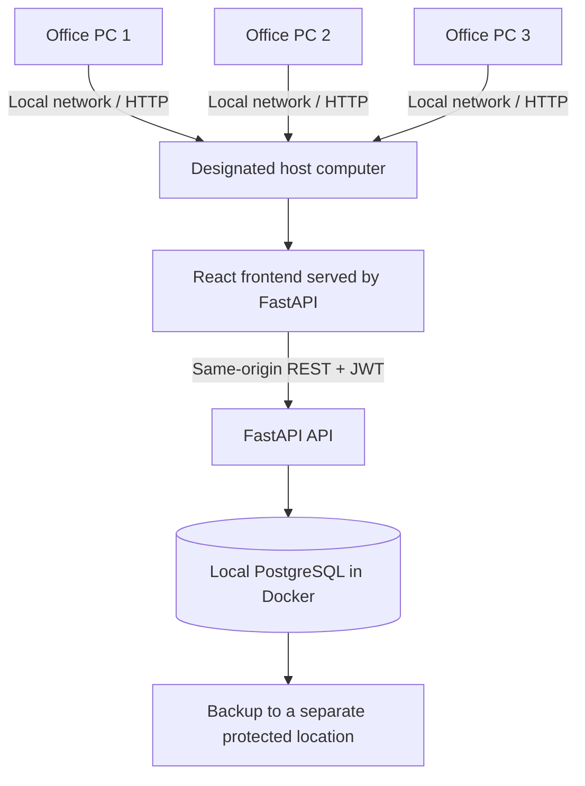

# 06 · Architecture and Deployment

The technology stack, system architecture, and the offline office-LAN deployment, backup/restore and handover plan. Combines the former Complete Tech Stacks and Offline LAN Deployment Guide.

**Status: preparation only.** The Docker setup has not been built from scratch on the barangay's computers, tested without internet on the real LAN, or approved by the client. **Do not use real resident records** until the client approves the design and the team verifies security, backups and recovery. Undecided items are tagged `(D-xx)`; see [08-Open-Decisions.md](08-Open-Decisions.md).

Versions are those resolved in `uv.lock` / `bun.lock` on **October 18, 2026** (frontend entries show the range pinned in `package.json`). Re-check before turnover.

Last updated: November 1, 2026

## 1. Architecture



- One designated office computer runs the React frontend (served by FastAPI), the FastAPI backend and PostgreSQL. Other authorized computers use a browser over the LAN. They need **no** Git, Docker or PostgreSQL.
- The frontend calls only the REST API (`/api/v1/...`). The API client in `frontend/src/client` is **generated from the backend's OpenAPI schema**, keeping types in sync.
- Login uses JWT bearer tokens; passwords are hashed with Argon2 (bcrypt supported).
- The Docker image builds the frontend and the backend serves it from the same origin — no separate frontend server and no separate API origin.
- No Vercel, Supabase or internet is needed for normal use. Internet is needed **once** beforehand to download the repo, packages and Docker images. Vercel configuration and Supabase pooler handling were removed from active code on Oct 25.
- This is **LAN operation without internet**, not a copy of the database on every computer. If the host or the LAN is down, other staff cannot use the system until it is restored.
- The Docker volume (`app-db-data`) keeps PostgreSQL data across restarts. **It is not a backup.**

## 2. Technology stack

### Backend

| Technology | Version | Purpose |
|---|---|---|
| Python | 3.14 (`.python-version`) | Language |
| FastAPI | 0.141.1 | Web framework, automatic API docs |
| Starlette / Uvicorn | 1.3.1 / 0.49.0 | ASGI toolkit / server |
| SQLModel / SQLAlchemy | 0.0.47 / 2.0.51 | ORM and database toolkit |
| Pydantic / pydantic-settings | 2.13.5 / 2.15.0 | Validation / configuration from env |
| Alembic | 1.20.0 | Database migrations |
| psycopg (binary) | 3.3.6 | PostgreSQL driver |
| PyJWT | 2.15.0 | Login tokens |
| pwdlib (argon2, bcrypt) | 0.3.1 | Password hashing |
| emails + Jinja2 | 1.1.2 / 3.1.6 | Templated email (disabled offline) |
| httpx | 0.28.1 | HTTP client / test client |
| Sentry SDK | 2.70.0 | Optional monitoring (off unless `SENTRY_DSN` set; leave unset offline) |

Key files: `backend/app/models.py` (tables, schemas), `backend/app/api/routes/` (endpoints), `backend/app/crud.py`, `backend/app/api/deps.py` (auth dependencies), `backend/app/core/config.py` (settings), `backend/app/alembic/versions/` (migrations).

### Frontend

| Technology | Version | Purpose |
|---|---|---|
| React / TypeScript | ^19.3 / ^6.0 | UI / typing |
| Vite | ^8.3 | Dev server and build |
| Tailwind CSS | ^4.2 | Styling |
| shadcn/ui + Radix UI | Radix 1.x | Accessible components (`src/components/ui`) |
| TanStack Router / Query / Table | ^1.170 / ^5.104 / ^9.2 | Routing (`src/routes`), server state, tables |
| React Hook Form + Zod | ^7.89 / ^4.6 | Forms and validation |
| Axios | 1.20.0 | HTTP client for the generated API client |
| @hey-api/openapi-ts | 0.97.3 | Generates the typed API client |
| Lucide React, React Icons | ^1.48 / ^5.7 | Icons |
| Sonner | ^2.0 | Toasts |
| Theme provider | built in | Light/dark (`src/components/theme-provider.tsx`) |

Branding (name, location, logo) is centralized in `frontend/src/config/site.ts`. TanStack devtools were removed.

### Database, hosting and tooling

| Component | Role | Notes |
|---|---|---|
| Docker Compose | Starts backend and database | Needs Docker Desktop or compatible Engine on the host |
| PostgreSQL 18 | Local database container | Data in `app-db-data` volume; back up separately |
| FastAPI | Serves API and built frontend on port `8000` | Container binds `0.0.0.0:8000`; Compose publishes the configured port |
| SMTP | Optional | **Disabled by default offline**; email-based setup/recovery will not work |
| Sentry | Optional | Leave unset offline unless reviewed |
| GitHub | Source control and CI | Development only; not needed at the client site |

| Dev tool | Purpose |
|---|---|
| uv | Python version, venv and dependency manager |
| Bun | JavaScript package manager and runner |
| Ruff · mypy, ty · Biome | Python lint/format · Python types · frontend lint/format |
| pytest + coverage · Playwright | Backend tests · end-to-end tests (`frontend/tests`) |
| pre-commit (prek) · GitHub Actions | Pre-commit checks · CI (backend, Playwright, pre-commit, secret scan, Zizmor, Docker Compose, offline verification) |
| React Email · Mailpit | Email templates (`packages/react-email`) · local fake mailbox |

Do not change the stack or remove starter-template modules just because they seem unnecessary; revisit after requirements are settled.

## 3. What is prepared in the repository

- Compose publishes the app port (default `8000`).
- The image builds the frontend and serves it through FastAPI on the same origin; a guarded SPA fallback serves local assets and `index.html` for client routes, blocks unknown `/api` paths from returning the frontend, and rejects paths that escape the frontend directory.
- PostgreSQL data persists in a named volume.
- SMTP and Sentry are disabled in the offline environment example.
- CI has an **offline deployment verification** job that runs the app on an internal Docker network with no internet egress, applies migrations, creates a test admin, checks local assets and the login route, exercises token authentication and confirms the app container cannot reach a public IP. This **simulates** offline behavior; it does not replace a physical test on the client's LAN.
- PowerShell backup and restore scripts exist (section 8). They have **not** been run on a Windows host.

## 4. Prepare the host computer

Documented assumption: a **Windows 10/11 64-bit** PC that can stay on during office hours, with enough disk space, reliable power, a supported Docker Desktop setup, and the same LAN as staff computers. The actual host, its OS and specs are unconfirmed **(D-31)**. Check Docker Desktop licensing terms for the client's use **(D-34, licence check still owed)**.

Before going offline, on a trusted development computer:

1. Clone/update the repo and check out `draft/admin-portal`, the branch the Version 1 demo runs from **(D-08, decided Nov 1, 2026)**.
2. Install and start Docker Desktop once.
3. Download images and build the app image while online.
4. Test the full setup with fictional data.
5. Copy the deployment materials to the host by an approved method.

Never copy production passwords, private keys or real resident records into the repo or class materials.

## 5. Configure the environment

From the repository root in PowerShell:

```powershell
Copy-Item .env.example .env
```

Set unique values in `.env` for: `SECRET_KEY` (random, ≥ 32 bytes), `POSTGRES_PASSWORD` (long, random, alphanumeric — avoid `@ : / #` until URL-encoding is handled in Compose), `FIRST_SUPERUSER`, `FIRST_SUPERUSER_PASSWORD`, `APP_PORT` (normally `8000`).

For a deployment test, remove `FASTAPI_ENV=development` or leave it blank (the settings accept `development` or unset, not `production`). In development mode weak-secret checks only warn; unset, default secrets or a signing key shorter than 32 bytes prevent startup. This alone does **not** make the app production-secure. Keep SMTP, Sentry and external database settings empty. Never commit `.env` or paste it into chats or issues.

## 6. Validate, build and start

Always pass `-f compose.yml` for the client install so development services in `compose.override.yml` are not loaded.

```powershell
docker compose -f compose.yml config --quiet
docker compose -f compose.yml build
docker compose -f compose.yml up -d
docker compose -f compose.yml ps
```

Wait for `db` and `backend` to be healthy; otherwise inspect `docker compose -f compose.yml logs --tail 100 db` / `backend`. On first install:

```powershell
docker compose -f compose.yml exec backend alembic upgrade head
docker compose -f compose.yml exec backend python app/initial_data.py
```

If the admin already exists, the script is **not** a password reset; use the approved recovery procedure **(D-12)**. Check `Invoke-WebRequest http://localhost:8000/api/v1/utils/health-check/`, then open `http://localhost:8000` and confirm login and pages load. A healthy endpoint alone does not mean deployment is complete.

## 7. Let office computers connect

1. Put the host and staff PCs on the same trusted private LAN. Never expose the service to the public internet.
2. On the host, run `ipconfig` and note the LAN IPv4 address.
3. In Windows Defender Firewall, allow inbound TCP **8000 on the Private profile only**, as needed. Do not disable the firewall.
4. From another PC open `http://<host-IPv4>:8000`.
5. Test login, search, data entry, printing, logout and simultaneous use from more than one computer.
6. Ask the network administrator to reserve the host's address in the router **(D-32)**.

This is **HTTP on a private LAN — not encrypted in transit**. A private LAN is not a substitute for authentication, least privilege or physical security **(D-33)**.

## 8. Backup and restore

Scripts (run from the repo root with Compose running):

```powershell
# Create a backup
.\scripts\backup-db.ps1

# Restore: first make a fresh backup of the current database, then restore the chosen dump
.\scripts\backup-db.ps1
.\scripts\restore-db.ps1 -BackupFile ".\backups\mayondon-db-YYYYMMDD-HHMMSS.dump"
```

The backup script creates a timestamped PostgreSQL custom-format dump in `backups\`, copies it out of the container and removes the temporary copy. `backups\` is git-ignored because dumps may contain resident data. The restore script requires typing `RESTORE`, verifies PostgreSQL can read the archive **before** stopping the backend, uses `pg_restore --exit-on-error`, and restarts the backend only after success. After a restore, verify login, representative records, document generation and main workflows; do not assume success because the command finished. Use only a backup from a compatible application/database version.

**Gaps vs the Creative Brief:**
- The brief requires **scheduled and manual** backups to an **external drive**. Only manual scripts exist; **scheduling (e.g. Windows Task Scheduler) is not built**, and neither the scripts nor a restore have been executed on Windows.
- The Admin "Backup and Restore" screen is a design concept and runs nothing.
- Needed: frequency, external-drive custody, retention, protection of backup files, restore responsibility, and a recorded recovery test **(D-35)**. A backup that stays only on the host does not survive disk failure, theft, ransomware or accidental deletion.

## 9. Offline limitations to resolve

- **Password recovery and account setup by email** depend on SMTP and will not work offline **(D-12)**.
- **ID photo background removal:** the client uses an online service today. Replace it with an approved local tool or a manual process; **never upload resident photos to an external service** **(D-18)**. The prototype removes the background in the browser with the MediaPipe selfie-segmentation files served from our own server (`/vision/selfie-segmentation/`, copied from `node_modules` by `vite.config.ts`). The camera needs `localhost` or https: plain `http://<LAN address>` blocks it.
- **External resources:** verify fonts, icons and scripts load offline (the packaged frontend uses local assets and same-origin calls).
- **API docs page:** the custom `/docs` endpoint uses CDN-hosted Swagger UI assets and may not render offline. **Decision (Nov 1, 2026, D-37):** staff do not need it offline, so leave it as is; package the assets only if wanted for a demo.
- **Updates and dependencies:** download and test before taking the host offline; never rely on live package downloads at the barangay.
- **Host availability:** other computers depend on the host and its database. Agree who restarts it, applies updates and handles hardware failure **(D-36)**.
- **Night-duty staff:** the brief lists a night-duty user, so the host must be on during those hours or the system will be unavailable **(D-31)**.
- **Data migration:** import spreadsheets only after agreeing field mapping, duplicate handling, validation and retention **(D-19)**.

## 10. Source-code protection and packaging

The GitHub repo is the team's **development workspace**. The barangay computer does not need a clone for normal operation. A private repository does not protect files already downloaded elsewhere.

1. Keep the private repo and development credentials on team computers; grant access only as needed.
2. Build and test on a trusted development computer.
3. Prepare a deployment package: production Docker images, a production Compose file, config templates and installation instructions. Prefer prebuilt images so the host needs no source tree.
4. Transfer the approved package and verify it runs **without cloning or accessing GitHub**.
5. Keep the real `.env` only on the host, restricted, with secrets different from development.
6. Never put GitHub passwords, tokens, SSH keys, development credentials or real resident data in the package or docs.

Illustrative layout (must match the repo's Docker config and be tested): `Mayondon-Deployment/` with `compose.production.yml`, `mayondon-backend.tar`, `mayondon-frontend.tar`, `deployment-instructions.pdf`, `scripts/`. Docker images reduce distributing the repo but do **not** make software impossible to copy; frontend code is inspectable in the browser.

Host rules: do not publish the PostgreSQL port to the LAN; keep the firewall on; do not save credentials in shortcuts, scripts or browser launch commands; use separate production secrets and staff accounts; limit Windows admin access and access to deployment files and database storage.

**Ownership and handover:** before turnover, agree with the instructor and client what source code, deployment files, documentation, maintenance support and usage rights are handed over. The repository is MIT-licensed (inherited from the template). Do not build hidden access or make the system depend on the students' personal accounts; the client must keep legitimate access to its records **(D-30)**.

## 11. One-time setup and daily startup

**Goal:** configure the host once so staff never run terminal commands. This is a **target**, not a verified capability.

**One-time setup by the team:** install and configure Docker Desktop; copy the approved package and configure the production `.env`; load images; initialize PostgreSQL, apply migrations, create the approved admin; configure Docker Desktop to start at Windows startup/sign-in; confirm restart policies and healthy services; configure firewall and LAN access; create a desktop shortcut or bookmark; document shutdown, restart, update, backup, restore and troubleshooting.

**Intended daily workflow:** turn on the host and sign in to Windows as required → Docker and the containers start per configuration → wait until the app is ready → open the shortcut (`http://localhost:8000` on the host, `http://<host-LAN-IP>:8000` elsewhere) → staff sign in. The host may also be a clerk workstation.

**Limitations to verify**
- A Compose restart policy restarts containers when Docker starts; it does **not** make Docker Desktop launch at Windows boot.
- Docker Desktop startup may depend on Windows sign-in and the configured account. **Decision (Nov 1, 2026, D-34):** plan for Docker Desktop to start at Windows **sign-in**, and state in the user manual that someone must sign in to the host first. Do not promise availability before anyone signs in until a real reboot test on the host succeeds. Consider another container runtime only if that test fails.
- A shortcut does not start the server; opening it before the app is healthy shows a connection error.
- Never store admin credentials in a shortcut or startup script; never disable the firewall to make access work.

## 12. Verification before client deployment

- [ ] Client approves the LAN hosting arrangement and identifies the host computer.
- [ ] The final brief and architecture docs reflect the offline model.
- [ ] The system starts after a host reboot without internet.
- [ ] A second computer can use the system with the internet disconnected.
- [ ] Login, staff account management, records, printing and concurrent access work.
- [ ] No feature sends resident data or photos to an external service.
- [ ] Email-dependent workflows have an approved offline alternative.
- [ ] Windows Firewall and LAN access configured and reviewed.
- [ ] Backup **and** restore tested and recorded; scheduled and manual backups to the external drive configured or their procedures documented.
- [ ] The account model (six full-access vs roles) reconciled and enforced in the backend.
- [ ] Permissions, password handling, staff training and Data Privacy Act requirements reviewed with the client.
- [ ] Client **and** instructor approval recorded before real data is loaded.
- [ ] Host restart does not lose database data; staff have simple instructions for checking readiness, opening the system and reporting problems.

This supports Client-Server Technologies and Networking 2 and informs Integrative Programming. It does not replace Instrument A/B, technology transfer records, the signed Certificate of Utilization or the final report.

## 13. Instructions for the user manual (after real deployment is verified)

Explain how to turn on and sign in to the host, tell when the system is ready, open it on the host and other computers, respond when the page does not load, who may restart the app or host, how to contact the support person, and how to shut down the host safely. Keep Docker commands in an administrator troubleshooting section.
