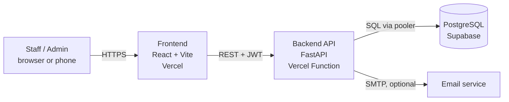

# Complete Tech Stacks

Everything used to build, test and deploy the system. Versions are the ones
resolved in `uv.lock` / `bun.lock` on October 18, 2026 (frontend entries show the
range pinned in `frontend/package.json`).

## 1. Architecture

- The frontend talks to the backend only through the REST API (`/api/v1/...`).
  The API client in `frontend/src/client` is generated from the backend's OpenAPI
  schema, so types stay in sync.
- Login uses JWT bearer tokens. Passwords are hashed (Argon2, with bcrypt supported).
- Locally, the same code runs with PostgreSQL in Docker. The backend can also
  serve the built frontend itself when `backend/app/frontend` exists.

> **Deployment status:** the Vercel + Supabase setup is the agreed plan and has
> **not been tested yet**. Section 6 lists what to verify at the first deploy.

## 2. Backend

| Technology | Version | Purpose |
|---|---|---|
| Python | 3.14 (`.python-version`) | Language |
| FastAPI | 0.141.1 | Web framework and automatic API docs (`/docs`) |
| Starlette | 1.3.1 | ASGI toolkit under FastAPI |
| Uvicorn | 0.49.0 | ASGI server (`fastapi dev` / `fastapi run`) |
| SQLModel | 0.0.47 | ORM: database models and Pydantic schemas in one |
| SQLAlchemy | 2.0.51 | Database toolkit under SQLModel |
| Pydantic | 2.13.5 | Data validation |
| pydantic-settings | 2.15.0 | Configuration from environment variables |
| Alembic | 1.20.0 | Database migrations |
| psycopg (binary) | 3.3.6 | PostgreSQL driver |
| PyJWT | 2.15.0 | JSON Web Tokens for login |
| pwdlib (argon2, bcrypt) | 0.3.1 | Password hashing |
| emails + Jinja2 | 1.1.2 / 3.1.6 | Sending templated email (password recovery, new account) |
| httpx | 0.28.1 | HTTP client (also used by the test client) |
| Sentry SDK | 2.70.0 | Optional error monitoring (off unless `SENTRY_DSN` is set) |

Key files: `backend/app/models.py` (tables and schemas), `backend/app/api/routes/`
(endpoints), `backend/app/crud.py`, `backend/app/api/deps.py` (auth dependencies),
`backend/app/core/config.py` (settings), `backend/app/alembic/versions/` (migrations).

## 3. Frontend

| Technology | Version | Purpose |
|---|---|---|
| React | ^19.3 | UI library |
| TypeScript | ^6.0 | Typed JavaScript |
| Vite | ^8.3 | Dev server and build tool |
| Tailwind CSS | ^4.2 | Utility-first styling |
| shadcn/ui + Radix UI | Radix 1.x | Accessible UI components (`src/components/ui`) |
| TanStack Router | ^1.170 | File-based routing (`src/routes`) |
| TanStack Query | ^5.104 | Server-state fetching and caching |
| TanStack Table | ^9.2 | Data tables |
| React Hook Form + Zod | ^7.89 / ^4.6 | Forms and validation |
| Axios | 1.20.0 | HTTP client used by the generated API client |
| @hey-api/openapi-ts | 0.97.3 | Generates the typed API client from OpenAPI |
| Lucide React, React Icons | ^1.48 / ^5.7 | Icons |
| Sonner | ^2.0 | Toast notifications |
| Theme provider | built in | Light and dark mode (`src/components/theme-provider.tsx`) |

The TanStack devtools (floating debug buttons) were removed from this project.
Branding (name, location, logo) lives in `frontend/src/config/site.ts`. The protected app shell has a responsive sidebar/header with breadcrumbs, and `/welcome` is a public landing page with placeholder announcements and contact details. Confirm all public-facing content with the client before publishing.

## 4. Database and hosting

| Service | Role | Notes |
|---|---|---|
| **Supabase** | Managed PostgreSQL | Used as a plain Postgres database; the app has its own users table and JWT login, so Supabase Auth is not used |
| **Vercel** | Hosts the frontend and FastAPI backend in two projects | Use Root Directory `frontend` for the Vite static site and `backend` for FastAPI. The backend declares `tool.vercel.entrypoint = "app.main:app"`. Verify both projects on first deployment. |
| Docker Compose | Local PostgreSQL and test mailbox only | `docker compose up -d db` (add `mailpit` to test emails). Not used for deployment |
| GitHub | Source control, pull requests, CI | |

**Supabase connection rules** (from Supabase's docs):
- For the serverless API on Vercel use the **transaction pooler** string,
  port **6543**. Set `DATABASE_POOL_MODE=transaction`; the engine uses SQLAlchemy's
  `NullPool` and disables psycopg prepared statements (`prepare_threshold=None`).
- The **direct** connection string is IPv6-only. The **session pooler** (port
  5432) supports IPv4 and is the recommended choice for running Alembic migrations.
  Set `MIGRATION_DATABASE_URL` to that session-pooler URL (or the direct URL when
  available) for migration commands. Do not run Alembic through port 6543.
- Always copy the exact string from the Supabase Dashboard → Connect.

## 5. Development tools

| Tool | Purpose |
|---|---|
| uv | Python version, virtual environment and dependency manager |
| Bun | JavaScript package manager and runner |
| Ruff | Python lint and format |
| mypy, ty | Python type checking |
| Biome | Frontend lint and format |
| pytest + coverage | Backend tests |
| Playwright | End-to-end browser tests (`frontend/tests`) |
| pre-commit (prek) | Checks before each commit |
| GitHub Actions | CI: backend tests, Playwright, pre-commit |
| React Email | Source of the email templates (`packages/react-email`, exported to `backend/app/email-templates`) |
| Mailpit | Local fake mailbox for testing emails |

## 6. Deployment checklist (code prepared; hosting untested)

Recommended starting setup: **one Vercel project using Vercel Services**, plus
one Supabase PostgreSQL project. Services lets the frontend and FastAPI backend
build separately while sharing one domain and deployment. The feature is currently
Beta and documented as available on all Vercel plans. If Services cannot be enabled
for this account, fall back to two Vercel projects and use the explicit CORS allowlist.

### Vercel project: frontend + backend Services

- [ ] Import the repository and set the project framework to **Services** in
  Vercel's Build and Deployment settings. A `services` block alone is not enough.
- [ ] The root `vercel.json` defines `frontend` at `frontend/` and `backend` at
  `backend/`, using Vite and FastAPI. The backend entrypoint is `app.main:app`.
- [ ] Keep the repository-root `package.json` and `bun.lock` available to the
  frontend service. Check the Vercel monorepo/root-file behavior on the first build.
- [ ] Set `VITE_BUILD_OUT_DIR=dist` so the frontend service builds to its static
  output directory rather than `../backend/app/frontend`.
- [ ] The root rewrite sends `/api` and `/api/*` to the backend, then other paths
  to the frontend. The frontend's own `vercel.json` rewrites SPA routes to
  `/index.html`. Test direct visits and refreshes on `/login` and `/items`.
- [ ] The frontend uses a relative API URL in production, so browser requests
  stay on the shared origin. Same-origin production requests do not need CORS.
- [ ] Set `DATABASE_URL` to the Supabase transaction pooler URL on port `6543`
  and set `DATABASE_POOL_MODE=transaction`.
- [ ] Set `SECRET_KEY`, `FIRST_SUPERUSER`, `FIRST_SUPERUSER_PASSWORD`,
  `PROJECT_NAME`, and any required email/Sentry settings in Vercel environment
  variables. Never commit actual values. Do not expose database secrets with a
  `VITE_` prefix.
- [ ] If using two separate Vercel projects instead, set `VITE_API_URL` to the
  backend origin and set `FRONTEND_HOSTS` to a comma-separated allowlist of exact
  production/preview frontend origins. Avoid broad wildcard CORS rules.

### Supabase database and migrations

- [ ] Copy the exact transaction-pooler connection string from Dashboard → Connect.
- [ ] From a trusted development machine, set `MIGRATION_DATABASE_URL` to the
  session-pooler URL on port `5432` (or a reachable direct URL), then run
  `uv run alembic upgrade head` from `backend`.
- [ ] Create the first admin using the existing initial-data script only after
  confirming its behavior and the production environment variables.
- [ ] Verify login, lockout, CRUD, logout, direct SPA route visits, and a migration
  against a non-production test database before client data is entered.
- [ ] Check current Vercel and Supabase free-tier limits, project pausing behavior,
  database backup options, and restore steps before Week 16 turnover.
- [ ] Confirm with Sir Ramos what Networking 2 expects for a cloud-hosted system
  and with Sir Matute what Client-Server Technologies requires.

**Official references checked October 18, 2026:**

- [Vercel Services guide and availability](https://vercel.com/kb/guide/vercel-services)
- [Vercel FastAPI entrypoint configuration](https://vercel.com/docs/frameworks/backend/fastapi)
- [Vercel Python runtime and supported versions](https://vercel.com/docs/functions/runtimes/python)
- [Vercel Vite SPA routing](https://vercel.com/docs/frameworks/frontend/vite)
- [Supabase PostgreSQL connection methods](https://supabase.com/docs/guides/database/connecting-to-postgres)
- [Supabase SQLAlchemy transaction-pooler guidance](https://supabase.com/docs/guides/troubleshooting/using-sqlalchemy-with-supabase-FUqebT)

**Status:** Configuration is prepared, but Vercel Services and Supabase have not
been deployed or tested. Treat the first preview deployment as a verification step,
not as proof of production readiness.
## 7. Security features in place

- Argon2 password hashing and timing-attack-safe login
- New passwords must be 12–128 characters; current-password verification remains compatible with existing passwords
- Account lockout after 5 consecutive failed login attempts for 15 minutes (configurable with `LOGIN_MAX_FAILED_ATTEMPTS` and `LOGIN_LOCKOUT_MINUTES`)
- Reusable `require_admin` dependency for admin-only routes
- Structured audit events for admin user creation, updates, and deletion, written to application logs without recording personal field values
- JWT bearer authentication; admin-only endpoints for user management
- Open registration disabled (`USERS_OPEN_REGISTRATION=False`)
- CORS restricted to the explicit `FRONTEND_HOSTS` allowlist, or the `FRONTEND_HOST` fallback
- Refuses default secrets outside development mode
- Secrets read from environment variables; `.env` is not committed

**Audit-log limitation:** these events are emitted to application logs, not stored in a dedicated database audit table. Confirm log access and retention before relying on them for formal records. If the client requires durable audit history, agree on retention and access rules before adding it.

## 8. How the stack maps to the four subjects

| Subject | Where it shows up |
|---|---|
| Principles of Web Design | React + Tailwind + shadcn/ui, theme and branding config, responsive layouts, mockups and style guide |
| Integrative Programming | SQLModel models, Alembic migrations, FastAPI routes, modules working together, report/print features |
| Client-Server Technologies | REST API with JWT, generated typed client, Vercel + Supabase deployment, environment configuration |
| Networking 2 | Cloud connectivity, HTTPS, CORS, access control, and whatever site-level checks the instructor requires |

## 9. Removed from the template

TanStack devtools · FastAPI Cloud deployment files · release and changelog
tooling · template documentation, images and logos · open sign-up · obsolete
`compose.deploy.yml` and its Traefik production proxy. `compose.yml` and
`compose.override.yml` remain for local PostgreSQL, Mailpit, backend integration,
and Playwright testing. The local stack uses direct service ports and no longer
requires Traefik.
