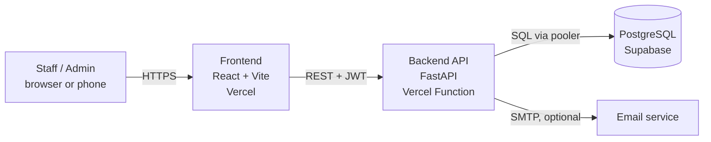

# Complete Tech Stacks

Everything used to build, test and deploy the system. Versions are the ones
resolved in `uv.lock` / `bun.lock` on October 18, 2026 (frontend entries show the
range pinned in `frontend/package.json`).

## 1. Architecture

- The frontend talks to the backend only through the REST API (`/api/v1/...`).
  The API client in `frontend/src/client` is generated from the backend's OpenAPI
  schema, so types stay in sync.
- Login uses JWT bearer tokens. Passwords are hashed (Argon2, with bcrypt supported).
- Locally, the same code runs with PostgreSQL in Docker. The backend can also
  serve the built frontend itself when `backend/app/frontend` exists.

> **Deployment status:** the Vercel + Supabase setup is the agreed plan and has
> **not been tested yet**. Section 6 lists what to verify at the first deploy.

## 2. Backend

| Technology | Version | Purpose |
|---|---|---|
| Python | 3.14 (`.python-version`) | Language |
| FastAPI | 0.141.1 | Web framework and automatic API docs (`/docs`) |
| Starlette | 1.3.1 | ASGI toolkit under FastAPI |
| Uvicorn | 0.49.0 | ASGI server (`fastapi dev` / `fastapi run`) |
| SQLModel | 0.0.47 | ORM: database models and Pydantic schemas in one |
| SQLAlchemy | 2.0.51 | Database toolkit under SQLModel |
| Pydantic | 2.13.5 | Data validation |
| pydantic-settings | 2.15.0 | Configuration from environment variables |
| Alembic | 1.20.0 | Database migrations |
| psycopg (binary) | 3.3.6 | PostgreSQL driver |
| PyJWT | 2.15.0 | JSON Web Tokens for login |
| pwdlib (argon2, bcrypt) | 0.3.1 | Password hashing |
| emails + Jinja2 | 1.1.2 / 3.1.6 | Sending templated email (password recovery, new account) |
| httpx | 0.28.1 | HTTP client (also used by the test client) |
| Sentry SDK | 2.70.0 | Optional error monitoring (off unless `SENTRY_DSN` is set) |

Key files: `backend/app/models.py` (tables and schemas), `backend/app/api/routes/`
(endpoints), `backend/app/crud.py`, `backend/app/api/deps.py` (auth dependencies),
`backend/app/core/config.py` (settings), `backend/app/alembic/versions/` (migrations).

## 3. Frontend

| Technology | Version | Purpose |
|---|---|---|
| React | ^19.3 | UI library |
| TypeScript | ^6.0 | Typed JavaScript |
| Vite | ^8.3 | Dev server and build tool |
| Tailwind CSS | ^4.2 | Utility-first styling |
| shadcn/ui + Radix UI | Radix 1.x | Accessible UI components (`src/components/ui`) |
| TanStack Router | ^1.170 | File-based routing (`src/routes`) |
| TanStack Query | ^5.104 | Server-state fetching and caching |
| TanStack Table | ^9.2 | Data tables |
| React Hook Form + Zod | ^7.89 / ^4.6 | Forms and validation |
| Axios | 1.20.0 | HTTP client used by the generated API client |
| @hey-api/openapi-ts | 0.97.3 | Generates the typed API client from OpenAPI |
| Lucide React, React Icons | ^1.48 / ^5.7 | Icons |
| Sonner | ^2.0 | Toast notifications |
| Theme provider | built in | Light and dark mode (`src/components/theme-provider.tsx`) |

The TanStack devtools (floating debug buttons) were removed from this project.
Branding (name, location, logo) lives in `frontend/src/config/site.ts`.

## 4. Database and hosting

| Service | Role | Notes |
|---|---|---|
| **Supabase** | Managed PostgreSQL | Used as a plain Postgres database; the app has its own users table and JWT login, so Supabase Auth is not used |
| **Vercel** | Hosts the frontend and the FastAPI backend | Vercel supports Python 3.12, 3.13 and 3.14 (default 3.12), detects FastAPI automatically, and runs the whole app as a single Vercel Function; pin the version with `.python-version` |
| Docker Compose | Local PostgreSQL and test mailbox only | `docker compose up -d db` (add `mailpit` to test emails). Not used for deployment |
| GitHub | Source control, pull requests, CI | |

**Supabase connection rules** (from Supabase's docs):
- For serverless apps (our API on Vercel) use the **transaction pooler** string,
  port **6543**. Transaction mode does not support prepared statements, and
  Supabase recommends SQLAlchemy's `NullPool` there.
- The **direct** connection string is IPv6-only. The **session pooler** (port
  5432) supports IPv4 and is the safer choice for running Alembic migrations.
- Always copy the exact string from the Supabase Dashboard → Connect.

## 5. Development tools

| Tool | Purpose |
|---|---|
| uv | Python version, virtual environment and dependency manager |
| Bun | JavaScript package manager and runner |
| Ruff | Python lint and format |
| mypy, ty | Python type checking |
| Biome | Frontend lint and format |
| pytest + coverage | Backend tests |
| Playwright | End-to-end browser tests (`frontend/tests`) |
| pre-commit (prek) | Checks before each commit |
| GitHub Actions | CI: backend tests, Playwright, pre-commit |
| React Email | Source of the email templates (`packages/react-email`, exported to `backend/app/email-templates`) |
| Mailpit | Local fake mailbox for testing emails |

## 6. Deployment checklist (verify at the first deploy)

Known gaps between the template and a Vercel + Supabase deployment:

- [ ] **Two Vercel projects** (recommended): one for `frontend` (Vite static build)
      and one for `backend` (FastAPI). Set the Root Directory of each.
- [ ] **Frontend build output.** `frontend/vite.config.ts` writes the build to
      `../backend/app/frontend`. For the frontend project, make the output
      directory configurable (for example `dist`) and set it in Vercel.
- [ ] **Single-page routing.** Add a Vercel rewrite so direct visits to routes like
      `/login` return `index.html`.
- [ ] **API URL.** Set `VITE_API_URL` in the frontend project to the backend's
      Vercel URL.
- [ ] **CORS.** Set `FRONTEND_HOST` in the backend project to the frontend's URL
      (the template allows one origin).
- [ ] **Database engine.** Point `DATABASE_URL` at the Supabase transaction pooler
      and adapt `backend/app/core/db.py` (`NullPool`, and disable psycopg's
      automatic prepared statements) as Supabase's docs advise.
- [ ] **Migrations.** Run `alembic upgrade head` and create the first admin with
      `python app/initial_data.py` against Supabase, from a laptop, using the
      session pooler or direct connection.
- [ ] **Secrets.** Set `SECRET_KEY`, `FIRST_SUPERUSER`, `FIRST_SUPERUSER_PASSWORD`,
      `DATABASE_URL` and `PROJECT_NAME` in Vercel (never in git). In production the
      app refuses the default `changethis` secrets on purpose.
- [ ] **Email.** Password recovery needs an SMTP provider. If the barangay has none,
      leave `SMTP_HOST` empty (recovery stays disabled) and let the admin reset passwords.
- [ ] **Free-tier limits.** Check the current Vercel and Supabase free-plan limits
      (and whether inactive projects pause) before the Week 16 turnover.
- [ ] **Backups.** Decide how the database is backed up before turnover.
- [ ] **Networking 2.** Confirm what Sir Ramos expects for a cloud-hosted system
      (see `Source-of-Truth.md`, open items).

## 7. Security features in place

- Argon2 password hashing and timing-attack-safe login
- JWT bearer authentication; admin-only endpoints for user management
- Open registration disabled (`USERS_OPEN_REGISTRATION=False`)
- CORS restricted to the configured frontend origin
- Refuses default secrets outside development mode
- Secrets read from environment variables; `.env` is not committed

## 8. How the stack maps to the four subjects

| Subject | Where it shows up |
|---|---|
| Principles of Web Design | React + Tailwind + shadcn/ui, theme and branding config, responsive layouts, mockups and style guide |
| Integrative Programming | SQLModel models, Alembic migrations, FastAPI routes, modules working together, report/print features |
| Client-Server Technologies | REST API with JWT, generated typed client, Vercel + Supabase deployment, environment configuration |
| Networking 2 | Cloud connectivity, HTTPS, CORS, access control, and whatever site-level checks the instructor requires |

## 9. Removed from the template

TanStack devtools · FastAPI Cloud deployment files · release and changelog
tooling · template documentation, images and logos · open sign-up. The Docker
Compose and Traefik deployment files (`compose.yml`, `compose.deploy.yml`,
related workflows) are still in the repo but unused for deployment; delete them
if the team agrees.
