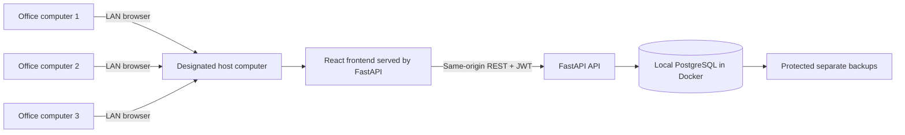

# Complete Tech Stacks

Everything used to build, test and deploy the system. Versions are the ones
resolved in `uv.lock` / `bun.lock` on October 18, 2026 (frontend entries show the
range pinned in `frontend/package.json`).

## 1. Architecture

- The frontend talks to the backend only through the REST API (`/api/v1/...`).
  The API client in `frontend/src/client` is generated from the backend's OpenAPI
  schema, so types stay in sync.
- Login uses JWT bearer tokens. Passwords are hashed (Argon2, with bcrypt supported).
- The current Docker image builds the frontend and the backend serves it from the same origin. This avoids a separate frontend server and avoids a separate API origin in the proposed LAN setup.
- The Compose database volume preserves PostgreSQL data across container restarts. It is not a backup.

> **Architecture status (October 25, 2026):** the client expressed a preference for a fully offline system on the barangay office LAN because the internet is slow. The repository now has an initial Docker-based self-hosting path, documented in [Offline-LAN-Deployment.md](Offline-LAN-Deployment.md). This is preparation only. The host computer, office LAN, firewall, no-internet behavior, backup/restore, photo workflow, and client approval remain unverified. Do not use real resident data until the actual deployment is tested and approved.

## 2. Backend

| Technology | Version | Purpose |
|---|---|---|
| Python | 3.14 (`.python-version`) | Language |
| FastAPI | 0.141.1 | Web framework and automatic API docs (`/docs`) |
| Starlette | 1.3.1 | ASGI toolkit under FastAPI |
| Uvicorn | 0.49.0 | ASGI server (`fastapi dev` / `fastapi run`) |
| SQLModel | 0.0.47 | ORM: database models and Pydantic schemas in one |
| SQLAlchemy | 2.0.51 | Database toolkit under SQLModel |
| Pydantic | 2.13.5 | Data validation |
| pydantic-settings | 2.15.0 | Configuration from environment variables |
| Alembic | 1.20.0 | Database migrations |
| psycopg (binary) | 3.3.6 | PostgreSQL driver |
| PyJWT | 2.15.0 | JSON Web Tokens for login |
| pwdlib (argon2, bcrypt) | 0.3.1 | Password hashing |
| emails + Jinja2 | 1.1.2 / 3.1.6 | Sending templated email (password recovery, new account) |
| httpx | 0.28.1 | HTTP client (also used by the test client) |
| Sentry SDK | 2.70.0 | Optional error monitoring (off unless `SENTRY_DSN` is set) |

Key files: `backend/app/models.py` (tables and schemas), `backend/app/api/routes/`
(endpoints), `backend/app/crud.py`, `backend/app/api/deps.py` (auth dependencies),
`backend/app/core/config.py` (settings), `backend/app/alembic/versions/` (migrations).

## 3. Frontend

| Technology | Version | Purpose |
|---|---|---|
| React | ^19.3 | UI library |
| TypeScript | ^6.0 | Typed JavaScript |
| Vite | ^8.3 | Dev server and build tool |
| Tailwind CSS | ^4.2 | Utility-first styling |
| shadcn/ui + Radix UI | Radix 1.x | Accessible UI components (`src/components/ui`) |
| TanStack Router | ^1.170 | File-based routing (`src/routes`) |
| TanStack Query | ^5.104 | Server-state fetching and caching |
| TanStack Table | ^9.2 | Data tables |
| React Hook Form + Zod | ^7.89 / ^4.6 | Forms and validation |
| Axios | 1.20.0 | HTTP client used by the generated API client |
| @hey-api/openapi-ts | 0.97.3 | Generates the typed API client from OpenAPI |
| Lucide React, React Icons | ^1.48 / ^5.7 | Icons |
| Sonner | ^2.0 | Toast notifications |
| Theme provider | built in | Light and dark mode (`src/components/theme-provider.tsx`) |

The TanStack devtools (floating debug buttons) were removed from this project.
Branding (name, location, logo) lives in `frontend/src/config/site.ts`. The protected app shell has a responsive sidebar/header with breadcrumbs, and `/welcome` is a public landing page with placeholder announcements and contact details. Confirm all public-facing content with the client before publishing.

## 4. Database and hosting

| Component | Offline/LAN role | Notes |
|---|---|---|
| Docker Compose | Starts the backend and local database | Requires Docker Desktop or a compatible Docker Engine on the host computer |
| PostgreSQL 18 | Local database container | Data is persisted in the `app-db-data` volume; create separate backups and test restore |
| FastAPI | Serves API and built frontend on port `8000` | The backend container binds to `0.0.0.0:8000`; Compose publishes the configured host port |
| React + Vite | Frontend built into the backend image | Staff access the same origin, normally `http://<host-LAN-IP>:8000` |
| Vercel + Supabase | Original online Foundation setup | Retained in repository configuration, but not used by the proposed offline Compose deployment |
| SMTP | Optional email service | Disabled by default for offline use; account recovery/setup by email will not work without a reachable approved SMTP server |
| Sentry | Optional external monitoring | Leave unset for offline client operation unless separately reviewed and approved |
| GitHub | Source control and CI | Development workflow only; not required for normal operation at the client site |

The offline deployment guide contains the current setup procedure, LAN access instructions, and unresolved limitations: [Offline-LAN-Deployment.md](Offline-LAN-Deployment.md).

## 5. Development tools

| Tool | Purpose |
|---|---|
| uv | Python version, virtual environment and dependency manager |
| Bun | JavaScript package manager and runner |
| Ruff | Python lint and format |
| mypy, ty | Python type checking |
| Biome | Frontend lint and format |
| pytest + coverage | Backend tests |
| Playwright | End-to-end browser tests (`frontend/tests`) |
| pre-commit (prek) | Checks before each commit |
| GitHub Actions | CI: backend tests, Playwright, pre-commit |
| React Email | Source of the email templates (`packages/react-email`, exported to `backend/app/email-templates`) |
| Mailpit | Local fake mailbox for testing emails |

## 6. Offline/LAN deployment checklist

The current target is a designated office computer hosting the frontend, API, and local PostgreSQL database. Do not use the old Vercel deployment checklist for the client installation.

- [ ] Review and approve the operating model in the signed Creative Brief.
- [ ] Build the Docker image while required dependencies and images are available.
- [ ] Configure unique `.env` secrets and strong initial administrator credentials.
- [ ] Start Compose, apply migrations, and initialize the first administrator.
- [ ] Confirm the packaged frontend and API load from the host computer.
- [ ] Confirm a second office computer can log in and perform core tasks using the host's LAN address.
- [ ] Disconnect internet access and repeat the core workflow tests.
- [ ] Verify all frontend assets and required application features work without external services.
- [ ] Agree on an offline alternative for email-based recovery and ID photo background removal.
- [ ] Configure and test database backup and restore to a separate protected location.
- [ ] Review firewall rules, account permissions, host availability, updates, and physical security.
- [ ] Complete Instrument A testing and retesting before client-site use.
- [ ] Complete Instrument B, training, user manual handover, and Certificate of Utilization only after the actual installation is tested and approved.

See [Offline-LAN-Deployment.md](Offline-LAN-Deployment.md) for detailed steps. This list is not evidence of a completed installation.