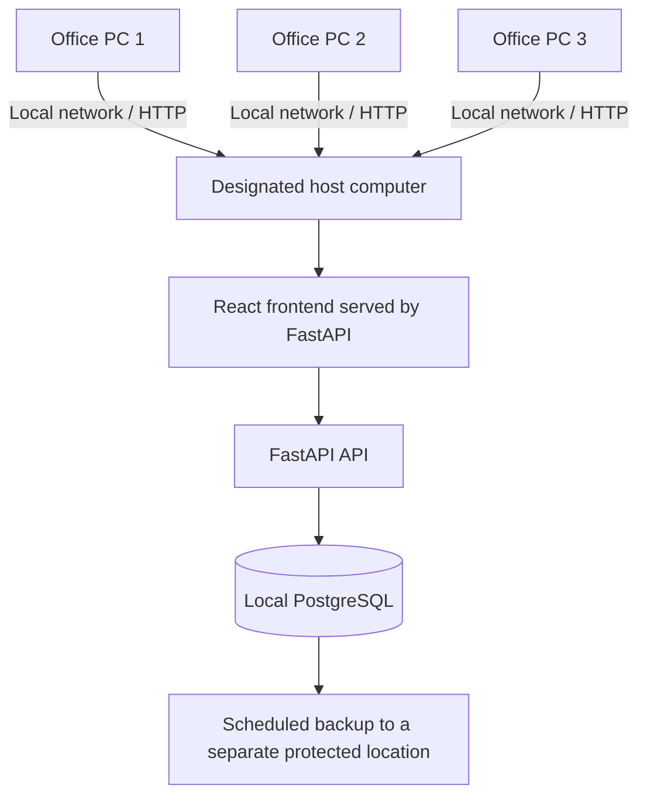

# Offline LAN Deployment Guide

**Status:** Initial self-hosting preparation. The setup has not yet been installed or tested on the barangay's actual computers and network. Do not use real resident records until the client approves the design and the team verifies security, backups, and recovery.

## 1. Target operating model

Use one designated office computer as the local application host. It runs the React frontend, FastAPI backend, and PostgreSQL database. Other authorized office computers open the system in a browser over the barangay's local network.



The application does not need Vercel, Supabase, or an internet connection during normal use. Internet access may still be needed once to download the repository, package dependencies, and Docker images before the deployment computer is taken offline. The office LAN, host computer, and local database must remain powered on for other computers to use the system.

This is **LAN operation without internet**, not a standalone copy of the database on every computer. If the host computer or local network is down, other staff cannot access the application until it is restored.

## 2. What has been prepared in the repository

- The Docker Compose backend publishes the application port, defaulting to `8000`.
- The Docker image builds the frontend and serves it through the FastAPI application on the same origin.
- PostgreSQL data is stored in a named Docker volume so it persists across container restarts.
- SMTP and Sentry are disabled by default in the offline environment example.
- Vercel and Supabase configuration files are retained as part of the original Foundation setup, but they are not part of the local LAN startup path.

These changes prepare a deployment path. They do not prove that the complete application is ready for the barangay. The current app still contains starter-template features that must be reviewed against the signed Creative Brief.

## 3. Prepare the host computer

Use a Windows 10/11 64-bit computer that can remain powered on during office hours. Confirm that it has sufficient disk space, reliable power, a supported Docker Desktop setup, and access to the same local network as staff computers.

Before going offline, on a trusted development computer:

1. Clone or update the repository and check out the agreed `Foundation` branch.
2. Install Docker Desktop and start it once.
3. Download the required Docker images and build the application image while internet access is available.
4. Test the full setup with fictional data before bringing it to the client site.
5. Copy the repository and required installation materials to the deployment computer using an approved method.

Do not copy production passwords, private keys, or real resident records into the repository or class materials.

## 4. Configure the local environment

From the repository root in PowerShell:

```powershell
Copy-Item .env.example .env
```

Edit `.env` and set unique values for:

- `SECRET_KEY`: a random secret of at least 32 bytes.
- `POSTGRES_PASSWORD`: a strong database password. Until URL-encoding is handled explicitly in the Compose configuration, use a long random alphanumeric password without URL-reserved characters such as `@`, `:`, `/`, or `#`.
- `FIRST_SUPERUSER`: the initial administrator username/email.
- `FIRST_SUPERUSER_PASSWORD`: a strong initial administrator password.
- `APP_PORT`: normally `8000`.

Keep SMTP, Sentry, and external hosted database settings empty for the offline deployment. Never commit the real `.env` file. The example values are placeholders and must be replaced.

## 5. Build and start the system

From the repository root:

```powershell
docker compose build
docker compose up -d
docker compose ps
```

Wait until the database and backend report healthy. On a first installation, apply migrations and create the initial administrator:

```powershell
docker compose exec backend alembic upgrade head
docker compose exec backend python app/initial_data.py
```

If the administrator already exists, the initialization script should not be treated as a way to reset its password. Follow the application's approved account-recovery procedure instead.

Check the health endpoint on the host computer:

```powershell
Invoke-WebRequest http://localhost:8000/api/v1/utils/health-check/
```

Open `http://localhost:8000` on the host computer and confirm that login and the expected pages load. Do not mark deployment complete based only on the health endpoint.

## 6. Allow office computers to connect

1. Connect the host computer and staff computers to the same trusted private LAN. Do not expose the service to the public internet.
2. On the host computer, run `ipconfig` and record the IPv4 address for the office LAN adapter.
3. In Windows Defender Firewall, allow inbound TCP traffic on port `8000` only on the Private profile and only as needed for the trusted office LAN. Do not disable the firewall.
4. On another office computer, open `http://<host-computer-IPv4>:8000` in a browser, replacing the placeholder with the host's actual LAN address.
5. Test login, record search, data entry, printing, logout, and simultaneous use from more than one authorized computer.
6. Ask the network administrator whether the host's address can be reserved in the router so it does not change unexpectedly.

This setup uses HTTP on a private LAN. It is not encrypted in transit. Before real resident data is used, the team must assess the actual network, access controls, and whether HTTPS is required for the client's risk level. A private LAN is not a substitute for application authentication, least-privilege permissions, or physical security.

## 7. Offline limitations to resolve

- **Password recovery and account setup by email:** These depend on SMTP and will not work when no mail service is configured. Admins must have a client-approved local account setup and password reset procedure. Do not leave staff locked out without a recovery plan.
- **ID photo background removal:** The client's current workflow uses an online service. That step must be replaced with an approved local tool or a manual process that does not upload resident photos to an external service.
- **External resources:** Verify that the UI, fonts, icons, scripts, and all other assets load without internet. The packaged frontend should use local assets and same-origin API calls.
- **Updates and dependencies:** Download and test updates before taking the host offline. Do not rely on live package downloads at the barangay.
- **Backups:** A Docker volume protects against ordinary container replacement but is not a backup. Set a backup schedule, store encrypted/protected copies separately from the host, and test restoring a backup before deployment.
- **Host availability:** Other computers depend on the host computer and its database. Agree who restarts it, applies updates, and responds to hardware failure.
- **Data migration:** Import existing spreadsheets only after agreeing on field mapping, duplicate handling, validation, and the client-approved retention process.

## 8. Backup and restore preparation

The repository includes PowerShell scripts for a basic local PostgreSQL backup and restore. Run them from the repository root with Docker Compose running.

Create a backup:

```powershell
.\scripts\backup-db.ps1
```

The script creates a timestamped PostgreSQL custom-format dump under `backups\`, copies it out of the database container, and removes its temporary container copy. The `backups\` directory is ignored by Git because backup files may contain resident personal information.

Before restoring, create a fresh backup of the current database. Then choose the dump file and run:

```powershell
.\scripts\backup-db.ps1
.\scripts\restore-db.ps1 -BackupFile ".\backups\mayondon-db-YYYYMMDD-HHMMSS.dump"
```

The restore script asks for the exact confirmation word `RESTORE`, checks that PostgreSQL can read the backup archive before stopping the backend, and uses `pg_restore --exit-on-error` during the restore. It starts the backend again only after the restore command succeeds. If the restore reports an error, keep the backend stopped and investigate before restarting the application. Restoring can replace existing database objects and data. Use only a backup from a compatible application/database version. After restore, verify login, representative records, document generation, and the main workflows before returning the system to use. Do not assume the restore succeeded solely because the command completed.

These scripts are initial utilities and still require execution and recovery testing on the actual deployment environment. Store a protected backup copy on a separate physical device or approved storage location, restrict access, and agree on a backup frequency with the client. A backup stored only on the host computer does not protect against disk failure, theft, ransomware, or accidental deletion.

## 9. Required verification before client deployment

- [ ] Client approves the LAN hosting arrangement and identifies the responsible host computer.
- [ ] The signed Creative Brief and architecture documents reflect the offline operating model.
- [ ] The system starts after a host reboot without requiring internet access.
- [ ] A second computer can use the system when the internet connection is disconnected.
- [ ] Login, staff account management, records, printing, and concurrent access work as expected.
- [ ] No feature sends resident data or photos to an external service.
- [ ] Email-dependent workflows have an approved offline alternative.
- [ ] Windows Firewall and LAN access are configured and reviewed.
- [ ] Backup and restore have been tested and recorded.
- [ ] User permissions, password handling, staff training, and the Data Privacy Act of 2012 requirements have been reviewed with the client.
- [ ] Client and instructor approval is recorded before real data is loaded.

This deployment guide supports the Client-Server Technologies and Networking 2 milestones, and informs the Integrative Programming work. It does not replace the testing instruments, technology-transfer records, signed Certificate of Utilization, or final report required by the project guide.
