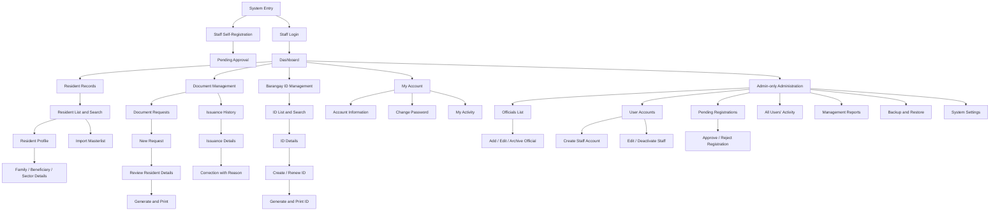

# Site Map and Design Draft

**Project:** Barangay Mayondon Records and Document Issuance System  
**Working branch:** `draft/admin-portal`  
**Status:** Design draft for group review and client validation  
**Last updated:** October 27, 2026

This document combines the initial site map with the current page-layout direction. It is a design working document, not a replacement for the Final Project Guide or a client-signed requirements document.

## 1. Design basis

The design is based on the October 19–20 client interviews and the current Creative Brief draft. The client described an office workflow using spreadsheets and document templates, repeated data entry, file-saving problems, and manual adjustments when printing onto pre-printed forms. The client prefers offline operation over the office local network.

The system is staff-facing. Do not add public resident accounts, public document applications, announcements, online payments, or blotter workflows without client confirmation. Do not use real resident data in sample screens, commits, or demonstrations.

## 2. Site map

The diagram shows the proposed information architecture, not a statement that every page is already implemented. Some entries may be tabs or subviews rather than separate URLs.

## 3. Main navigation draft

### Common navigation
1. Dashboard
2. Resident Records
3. Document Management
   - Document Requests
   - Issuance History
4. Barangay ID Management
5. My Account
6. My Activity

### Admin-only navigation
1. Officials
2. User Accounts
3. Pending Registrations
4. All Users' Activity
5. Management Reports
6. Backup and Restore
7. System Settings

The Staff account should not see admin-only navigation. The backend must still enforce authorization for every protected action. Hiding a menu item is not a security control.

## 4. Page and layout draft

### Dashboard
- Page title and a short description of the system's purpose.
- Summary cards for document issuances and upcoming expiry reminders, using real database values when connected.
- Quick links to Resident Records, Document Requests, Issuance History, and Barangay IDs.
- Recent activity is limited to the current user's actions for Staff. Admin may see a system-wide activity summary if approved.
- Any prototype values must be visibly identified as sample data. Never present invented figures as barangay statistics.

### Resident Records
- Page heading, search, and clear primary actions.
- Search by the approved identifiers and resident details the client confirms.
- Table/list of residents with responsive horizontal scrolling or a mobile-friendly card layout.
- Resident profile with relevant personal details, family/beneficiary/sector information, ID information, and issuance history.
- Import flow with file selection, preview, validation errors, duplicate detection, and a summary of imported, updated, skipped, and failed rows.
- Archive/inactive status instead of ordinary permanent deletion.

### Document Management
- Keep requests separate from issued-document history.
- New request workflow should select the resident first, then document type and purpose, then show only the fields required by that document.
- Reuse saved resident details where appropriate to reduce repeated typing.
- Printing must support the client's existing pre-printed paper workflow: print only the variable data onto the blank pre-printed form. Alignment needs physical testing with the actual printer, paper, scaling settings, and margins.
- Issuance history should preserve the original record. Corrections require a reason and an audit entry instead of silently overwriting or deleting the original issuance.

### Barangay ID Management
- Searchable list of ID records.
- Preserve the existing ID numbering series.
- Show validity and the relevant registration status used by the office.
- Support the client-described normal one-year validity and six-month validity for new/renting residents until the stated proof is provided, subject to confirmation of the final rule.
- Support ID photo upload and print layout. Do not assume photo background removal can work offline unless a local solution is verified.

### Officials
- Admin-only list separate from login accounts.
- Proposed fields: full name, position, term start/end, active/inactive status, and optional photo only if the client needs it.
- Prefer archive/inactive status for former officials so historical records remain understandable.
- Adding an official must never automatically create a login account.

### User Accounts and Registration
- Admin can create an active Staff account directly.
- Staff self-registration creates a pending account.
- Only Admin can approve or reject a pending registration.
- Pending and rejected accounts must not access protected application pages or API operations.
- No public Admin registration. The first Admin account is provisioned through controlled initial setup.

### Activity Log
- Staff can see only their own activity.
- Admin can search and filter activity across users.
- Capture actor, action, module, record reference, timestamp, outcome, and reason when required.
- Do not log passwords, tokens, or unnecessary resident personal information.
- Ordinary users cannot edit or delete audit history.

### Reports, settings, and backup
- Management reports should focus on useful office summaries such as issuances by date/type/purpose, expiring records, imports, corrections, and account activity. Confirm report needs with the client.
- System settings should contain only settings that are agreed and supported.
- Backup and restore are Admin-only. Include clear confirmation before destructive restore actions and record the outcome. The backup destination, schedule, responsibility, and restore procedure still require practical verification.

## 5. Visual direction

- **Style:** formal, calm, clean, office-focused.
- **Palette direction:** navy blue, white, and light gray based on the client-provided logo. Confirm exact colors before finalizing.
- **Typography:** readable sans-serif such as Arial or the existing interface font if it remains consistent and legible.
- **Layout:** persistent sidebar on desktop, collapsible navigation on small screens, clear page titles, consistent spacing, visible focus states, and tables that remain usable on phones.
- **Components:** consistent summary cards, page headings, search fields, data tables, status labels, confirmation dialogs, and form controls.
- **Forms:** clear labels, inline validation, grouped related fields, and an explicit save/cancel action.
- **Printing:** screen styling must not be assumed to equal print styling. Build and test a separate print layout against the client's actual pre-printed forms.

## 6. Current branch prototype notes

The current `draft/admin-portal` branch already contains draft pages for Dashboard, Records Management, Issuances Management, Officials, User Management, and System Settings. Several pages use hard-coded sample data and are not connected to a complete backend workflow. Treat these pages as visual prototypes, not operational features.

The existing prototype should be aligned with the current scope:
- Replace population, household, voter, and issuance figures with clearly marked sample values until real aggregate data is connected.
- Avoid making unsupported population/voter management a primary module unless the client confirms it is needed.
- Separate request entry from issuance history.
- Remove the public-announcement direction from the welcome screen unless the client requests a public-facing site.
- Move activity logs out of System Settings into a clear Activity Log page with role-dependent visibility.
- Keep Officials management separate from User Management.
- Do not show links to pages until a draft route or screen exists.

## 7. Open items to validate

- Exact final document types and the approved template for each.
- Which resident fields are required for each document.
- Final rules for ID validity, resident registration status, and existing ID numbering.
- Whether family/beneficiary/sector information should be a tab in the resident profile or a separate screen.
- Which reports the client actually needs.
- Which account can perform each action and who will own backup/restore duties.
- Actual printer, paper dimensions, print margins, and alignment procedure for pre-printed forms.
- Client review and approval of the site map and visual design.

## 8. Week 14 checklist

- [ ] Review the site map as a group.
- [ ] Validate the workflows and exclusions against the Creative Brief and interview notes.
- [ ] Present the draft to the client and record feedback before treating the design as approved.
- [ ] Prepare wireframes for the main workflows.
- [ ] Prepare full-color mockups for at least the suggested five main pages.
- [ ] Prepare a one-page style guide and mobile mockups for at least the suggested two pages.
- [ ] Confirm suggested quantities with Prof. Camba.
- [ ] Revise the designs from client feedback before coding against them.

## 9. Creative Brief alignment review — October 27, 2026

This checklist compares the Creative Brief with the current branch. A draft screen is not evidence that the feature is operational or approved.

| Requirement from the Creative Brief | Current branch design status | Remaining work |
|---|---|---|
| Dashboard: issued documents and expiring clearances/IDs | Previous dashboard layout retained. Displayed values are sample values. | Keep the layout. Connect verified database totals later and label prototype data clearly. |
| Resident records: add, edit, search | Resident Records draft now prioritizes residents, sample ID references, resident type, registration status, and archive status. | Resident create/edit/profile actions and backend persistence are not implemented. Confirm search fields with the client. |
| Family, beneficiary, and marginalized-sector details | A draft tab describes these groups of information. | Confirm actual fields and sector categories against the client-provided masterlists. |
| Import existing masterlists | Draft file-selection area and planned validation summary are shown. | File parsing, column mapping, preview, validation, duplicate detection, and import are not implemented. |
| Resident and Barangay ID records | A dedicated Barangay ID Management draft route is now present with searchable sample records, status filter, issue/expiry dates, and Create, Details, Renew, and Print prototype actions. | Connect to resident and ID records, verify status/validity rules with the client, implement photo handling and numbering, and build/test the approved physical ID print layout. |
| Document request entry and editable purpose list | Document Management now has a sample resident selector before document type and pre-fills sample name/address. Drafts still live only in session state. | Connect selector to saved Resident Records, confirm fields for each document, make the purpose list maintainable, and persist requests/issuances in the database. |
| Separate issuance history with issue and expiry dates | Issuance History tab exists, but records are sample/session-only and no expiry date is shown. | Add persistent issuance records, expiry where applicable, details, and correction history that preserves the original. |
| Auto-filled printing with existing formats | Current print view is a generic draft preview. | Create a separate print layout per approved document, then calibrate against actual pre-printed paper and the client printer. Signatures and dry seals remain manual. |
| Six staff accounts with full access | Current branch has Admin-only routes and navigation for Officials, User Accounts, and System Settings. | **Requirements conflict:** the Creative Brief says all six staff accounts have full access, while prior workflow planning has Admin and Staff permission differences. Confirm this with the client before changing access controls. |
| Local scheduled and manual backup/restore | No dedicated Backup and Restore screen in the navigation. | Draft Admin-accessible backup/restore UI and define destination, schedule, confirmation, restore procedure, and outcome display. Actual backup automation and restore tests remain separate work. |
| Fully offline local-network use | Deployment foundation exists, but client-site LAN operation is not yet verified. | Test host startup, access from other office computers, printer operation, firewall configuration, and recovery without internet. |
| Public-facing features excluded | Welcome page is staff-oriented; no public announcement module is intended. | Keep public resident access, online applications, payments, announcements, and blotter workflows out of scope. |

### Remaining design priorities

1. Connect resident-first Document Management to saved resident records and add purpose-list maintenance.
2. Continue the admin-page drafts only after confirming the account access model.
3. Draft Officials, User Accounts, Pending Registrations, Activity Log, Management Reports, Backup and Restore screens only after confirming the access model.
4. Keep the previous dashboard layout unchanged unless the group and client explicitly request a redesign.
5. Label every hard-coded row and figure as sample data. Do not use actual resident records in screenshots, commits, or demonstrations.
6. Validate the site map and mockups with the client before treating the design as approved.

## 10. Barangay ID Management draft — October 27, 2026

A dedicated route, `/barangay-ids`, has been added to the `draft/admin-portal` prototype. The page includes:
- Search by sample resident, reference, resident type, and status.
- Status filter for Valid, Expiring soon, Expired, and Archived.
- Sample issue and expiry dates and registration status.
- Prototype actions for Create Barangay ID, Details, Renew, and Print.
- A reminder to confirm ID numbering, validity rules, registration requirements, and the approved print layout.

The route currently uses hard-coded sample data. The buttons display a prototype notice. There is no database persistence, resident lookup, photo upload/storage, ID number assignment, expiry calculation, renewal workflow, or physical print calibration yet. These controls are layout placeholders, not working ID operations.

Before implementation, confirm the existing ID numbering series, the normal one-year validity rule, the six-month rule for new/renting residents, and the proof needed to change registration status with the client. Test the approved layout with the actual ID dimensions and printer.

## 11. Document Management resident-first draft — October 27, 2026

The Issue Document view now begins with a resident selector before document type and document fields. Selecting one of the clearly labeled sample residents pre-fills the name and address fields. Saving a draft is blocked until a resident is selected.

Current limitations:
- The resident selector uses hard-coded sample records and is not connected to Resident Records or the database.
- Drafts are kept in the current browser session only and are not official issuances.
- Document purposes are still hard-coded.
- Document types and fields still require client confirmation against the supplied paper forms.
- The print review remains a generic preview and is not aligned to the actual pre-printed forms.
- Persistent issuance history, expiry handling where applicable, and corrections with a reason are not implemented.

The next implementation step should be to connect the resident selector to the approved resident search/list API after the resident-record schema and required fields are confirmed. Do not treat the sample list as real client data.

## 12. Client-provided hard-copy form specifications — October 27, 2026

### Printing rule for every form

The system must print typed values only onto the client's existing pre-printed paper. It must not recreate or print the letterhead, logos or watermark, document title, fixed paragraphs, pre-printed field labels/colons, signatory's existing signature, DRY SEAL label, or footer. Staff will apply the dry seal and residents will complete the thumbmark and signature areas by hand where applicable. The system's print output must be a transparent field overlay, not a redesigned document.

Paper size, printer, orientation, margins, scaling, exact field coordinates, and photo dimensions remain unconfirmed. Do not finalize print coordinates until the client provides or approves physical samples and a calibration test is completed. Browser print must use actual size / 100% scaling, with headers and footers disabled where the browser offers those settings.

### Form-specific typed content

1. **Barangay Clearance**
   - Date at the top right, above the pre-printed Date line.
   - Name, address, age calculated from birthdate, birthdate, birthplace, civil status, purpose, purpose note on the following line, remarks, and a second remarks line such as `c/o [Kagawad]`.
   - Resident photo in the designated box on the right.
   - Bottom fields: valid ID presented, ID number, place of issue, date of issue, and official receipt number.
   - Do not print in the right thumbmark box or resident signature line.
   - The pre-printed two-month validity statement, Punong Barangay signature, watermark, letterhead, labels, and footer must not be printed by the system.

2. **Certificate of Indigency**
   - Date, name, address, age, sector, purpose, and the line `Addressed to the office of [office]`.
   - The `SECTOR :` label is not pre-printed and must be included in the typed overlay together with one or two sector names.
   - Punong Barangay signature and all other pre-printed elements remain on the paper.

3. **Barangay Clearance (Electrical and Water Connection)**
   - Date, check marks for Electric and/or Water, name, address, one choice between New and Reconnection, one choice between Residential and Commercial, location, CTC number, place of issue, date of issue, and official receipt number.
   - Use the specific pre-printed paper variant with the different letterhead email. Do not print any letterhead.

4. **Barangay Franchise Clearance (tricycle)**
   - Date, name, address, tricycle association, and an indented vehicle-details block containing make, type of body, motor number, color, and plate number.
   - Bottom fields: CTC number, place of issue, date of issue, and official receipt number.

5. **Certification for assistance request (likely Damayan)**
   - Treat as a separate form layout, not as a clearance layout.
   - Logo is pre-printed at the top left, with no watermark and no DRY SEAL label.
   - Print values directly on the existing underlines or inside parentheses: name after Mr./Ms.; address after resident of; years of residency; sector; one assistance choice (financial, medical, or burial); one recipient choice (oneself or relationship); name under which assistance is requested; and day, month, and year in the Given this line.
   - Signatory is a Barangay Kagawad, unlike the clearance forms signed by the Punong Barangay.

6. **Barangay ID front**
   - Print only the remaining ID number after the pre-printed `ID No. 18-128-3597-` prefix, the full name and address inside the light-blue block above the pre-printed `MAYONDON, LOS BAÑOS, LAGUNA` line, and the resident photo inside the photo box.
   - Do not print the logo, government/place heading, number prefix, blue block, motto/footer, or any other pre-printed element.

7. **Barangay ID back**
   - Print values for birthdate, birthplace, sex, civil status, valid until, emergency contact name, emergency contact address, and emergency contact number.
   - Do not print the pre-printed labels, red emergency-contact heading, signatures, countersignature, blue footer band, or warning text.

### Print-template implementation requirements

- Keep each form template separate. Clearance forms, the assistance certification, ID front, and ID back have different layouts and must not share one generic print page.
- Store field positions and photo boxes as template-specific configuration, preferably relative to the confirmed paper dimensions. Positions in the current prototype are not calibrated.
- Print typed text only. Avoid rendering logos, labels, field captions, signature images, borders, footers, or decorative content in the print layer.
- Keep thumbmark and resident signature areas blank. Keep signatory signature areas blank in the overlay so the pre-printed signature remains visible.
- Compute age from birthdate for Barangay Clearance and any other approved form that requires age. Confirm how to handle a missing or invalid birthdate.
- For choice fields, print the mark only inside the corresponding pre-printed box or parentheses. Do not print both options as text when only one is selected.
- For photos, use the client-approved size and placement, preserving the aspect ratio according to client preference.
- Provide a print calibration mode or checklist using a plain test sheet before printing on official pre-printed stock. Verify all seven templates against actual paper.
- Test that the printer does not scale, crop, or shift the overlay. Record printer model, paper size, orientation, scaling setting, and approved template revision.

### Decisions still required from the client

- Confirm paper/card dimensions and orientation for all seven layouts.
- Provide or approve physical samples, especially the two Barangay ID sides and assistance certification.
- Confirm the exact name and fields for the assistance certification and whether it is the Damayan form.
- Confirm the allowed sector choices, purpose notes, remarks defaults, and office-addressed wording.
- Confirm photo dimensions/cropping, and whether the photo is captured, uploaded, or selected from an existing resident record.
- Confirm age calculation and the source of the birthdate.
- Confirm the actual printer(s) and whether every workstation uses the same printer settings.

### Prototype safety update — October 27, 2026

The generic document print action has been paused. It no longer opens the browser print dialog for the current generic layout, because printing labels, logos, or other recreated elements would conflict with the client's pre-printed form workflow. The UI now explains that printing is unavailable until form-specific overlay positions are calibrated. This is an intentional safeguard, not completed printing functionality.

## 13. Scope and design clarification — October 28, 2026

The project team confirmed that the Admin/Staff role distinction and Staff self-registration with Admin approval are intentional proposed designs. They are not accidental conflicts with the Creative Brief. Keep these designs in the prototype for the team's client proposal and validation. The current permission rules are still a proposed design and must be explained to the client before final implementation.

Damayan and other document types discussed in the interviews or represented by client-provided forms are also part of the design scope. The Creative Brief is not the only source for identifying possible document templates. Keep additional document forms as sample/provisional designs when exact requirements still need confirmation.

### Newly added draft pages

The following routes are now represented in `draft/admin-portal` and use clearly identified sample data or sample-only actions:

- `/my-activity` — staff member's own activity history.
- `/pending-registrations` — admin review of sample staff registration requests, with sample approve/reject states.
- `/activity-log` — admin view of sample activity across users.
- `/reports` — sample report selection and report preview area.
- `/backup-restore` — manual backup concept, proposed schedule controls, sample backup history, and restore preparation/confirmation layout.

These are design prototypes. The added controls do not write to the database, generate reports, change real account states, or run backup/restore operations. The Backup and Restore page must be connected to the approved local scripts and tested before being treated as operational. A real restore can replace current data, so production restore must use explicit authorization, a verified archive, a clear confirmation step, and a tested recovery procedure.

The sidebar now includes My Activity under common navigation and Pending Registrations, All Users' Activity, Management Reports, and Backup and Restore under Admin-only navigation. The earlier dashboard layout remains unchanged.

