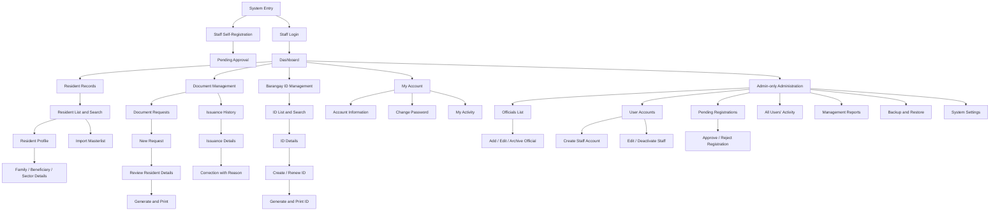

# Site Map and Design Draft

**Project:** Barangay Mayondon Records and Document Issuance System  
**Working branch:** `draft/admin-portal`  
**Status:** Design draft for group review and client validation  
**Last updated:** October 27, 2026

This document combines the initial site map with the current page-layout direction. It is a design working document, not a replacement for the Final Project Guide or a client-signed requirements document.

## 1. Design basis

The design is based on the October 19–20 client interviews and the current Creative Brief draft. The client described an office workflow using spreadsheets and document templates, repeated data entry, file-saving problems, and manual adjustments when printing onto pre-printed forms. The client prefers offline operation over the office local network.

The system is staff-facing. Do not add public resident accounts, public document applications, announcements, online payments, or blotter workflows without client confirmation. Do not use real resident data in sample screens, commits, or demonstrations.

## 2. Site map

The diagram shows the proposed information architecture, not a statement that every page is already implemented. Some entries may be tabs or subviews rather than separate URLs.

## 3. Main navigation draft

### Common navigation
1. Dashboard
2. Resident Records
3. Document Management
   - Document Requests
   - Issuance History
4. Barangay ID Management
5. My Account
6. My Activity

### Admin-only navigation
1. Officials
2. User Accounts
3. Pending Registrations
4. All Users' Activity
5. Management Reports
6. Backup and Restore
7. System Settings

The Staff account should not see admin-only navigation. The backend must still enforce authorization for every protected action. Hiding a menu item is not a security control.

## 4. Page and layout draft

### Dashboard
- Page title and a short description of the system's purpose.
- Summary cards for document issuances and upcoming expiry reminders, using real database values when connected.
- Quick links to Resident Records, Document Requests, Issuance History, and Barangay IDs.
- Recent activity is limited to the current user's actions for Staff. Admin may see a system-wide activity summary if approved.
- Any prototype values must be visibly identified as sample data. Never present invented figures as barangay statistics.

### Resident Records
- Page heading, search, and clear primary actions.
- Search by the approved identifiers and resident details the client confirms.
- Table/list of residents with responsive horizontal scrolling or a mobile-friendly card layout.
- Resident profile with relevant personal details, family/beneficiary/sector information, ID information, and issuance history.
- Import flow with file selection, preview, validation errors, duplicate detection, and a summary of imported, updated, skipped, and failed rows.
- Archive/inactive status instead of ordinary permanent deletion.

### Document Management
- Keep requests separate from issued-document history.
- New request workflow should select the resident first, then document type and purpose, then show only the fields required by that document.
- Reuse saved resident details where appropriate to reduce repeated typing.
- Printing must support the client's existing pre-printed paper workflow: print only the variable data onto the blank pre-printed form. Alignment needs physical testing with the actual printer, paper, scaling settings, and margins.
- Issuance history should preserve the original record. Corrections require a reason and an audit entry instead of silently overwriting or deleting the original issuance.

### Barangay ID Management
- Searchable list of ID records.
- Preserve the existing ID numbering series.
- Show validity and the relevant registration status used by the office.
- Support the client-described normal one-year validity and six-month validity for new/renting residents until the stated proof is provided, subject to confirmation of the final rule.
- Support ID photo upload and print layout. Do not assume photo background removal can work offline unless a local solution is verified.

### Officials
- Admin-only list separate from login accounts.
- Proposed fields: full name, position, term start/end, active/inactive status, and optional photo only if the client needs it.
- Prefer archive/inactive status for former officials so historical records remain understandable.
- Adding an official must never automatically create a login account.

### User Accounts and Registration
- Admin can create an active Staff account directly.
- Staff self-registration creates a pending account.
- Only Admin can approve or reject a pending registration.
- Pending and rejected accounts must not access protected application pages or API operations.
- No public Admin registration. The first Admin account is provisioned through controlled initial setup.

### Activity Log
- Staff can see only their own activity.
- Admin can search and filter activity across users.
- Capture actor, action, module, record reference, timestamp, outcome, and reason when required.
- Do not log passwords, tokens, or unnecessary resident personal information.
- Ordinary users cannot edit or delete audit history.

### Reports, settings, and backup
- Management reports should focus on useful office summaries such as issuances by date/type/purpose, expiring records, imports, corrections, and account activity. Confirm report needs with the client.
- System settings should contain only settings that are agreed and supported.
- Backup and restore are Admin-only. Include clear confirmation before destructive restore actions and record the outcome. The backup destination, schedule, responsibility, and restore procedure still require practical verification.

## 5. Visual direction

- **Style:** formal, calm, clean, office-focused.
- **Palette direction:** navy blue, white, and light gray based on the client-provided logo. Confirm exact colors before finalizing.
- **Typography:** readable sans-serif such as Arial or the existing interface font if it remains consistent and legible.
- **Layout:** persistent sidebar on desktop, collapsible navigation on small screens, clear page titles, consistent spacing, visible focus states, and tables that remain usable on phones.
- **Components:** consistent summary cards, page headings, search fields, data tables, status labels, confirmation dialogs, and form controls.
- **Forms:** clear labels, inline validation, grouped related fields, and an explicit save/cancel action.
- **Printing:** screen styling must not be assumed to equal print styling. Build and test a separate print layout against the client's actual pre-printed forms.

## 6. Current branch prototype notes

The current `draft/admin-portal` branch already contains draft pages for Dashboard, Records Management, Issuances Management, Officials, User Management, and System Settings. Several pages use hard-coded sample data and are not connected to a complete backend workflow. Treat these pages as visual prototypes, not operational features.

The existing prototype should be aligned with the current scope:
- Replace population, household, voter, and issuance figures with clearly marked sample values until real aggregate data is connected.
- Avoid making unsupported population/voter management a primary module unless the client confirms it is needed.
- Separate request entry from issuance history.
- Remove the public-announcement direction from the welcome screen unless the client requests a public-facing site.
- Move activity logs out of System Settings into a clear Activity Log page with role-dependent visibility.
- Keep Officials management separate from User Management.
- Do not show links to pages until a draft route or screen exists.

## 7. Open items to validate

- Exact final document types and the approved template for each.
- Which resident fields are required for each document.
- Final rules for ID validity, resident registration status, and existing ID numbering.
- Whether family/beneficiary/sector information should be a tab in the resident profile or a separate screen.
- Which reports the client actually needs.
- Which account can perform each action and who will own backup/restore duties.
- Actual printer, paper dimensions, print margins, and alignment procedure for pre-printed forms.
- Client review and approval of the site map and visual design.

## 8. Week 14 checklist

- [ ] Review the site map as a group.
- [ ] Validate the workflows and exclusions against the Creative Brief and interview notes.
- [ ] Present the draft to the client and record feedback before treating the design as approved.
- [ ] Prepare wireframes for the main workflows.
- [ ] Prepare full-color mockups for at least the suggested five main pages.
- [ ] Prepare a one-page style guide and mobile mockups for at least the suggested two pages.
- [ ] Confirm suggested quantities with Prof. Camba.
- [ ] Revise the designs from client feedback before coding against them.

## 9. Creative Brief alignment review — October 27, 2026

This checklist compares the Creative Brief with the current branch. A draft screen is not evidence that the feature is operational or approved.

| Requirement from the Creative Brief | Current branch design status | Remaining work |
|---|---|---|
| Dashboard: issued documents and expiring clearances/IDs | Previous dashboard layout retained. Displayed values are sample values. | Keep the layout. Connect verified database totals later and label prototype data clearly. |
| Resident records: add, edit, search | Resident Records draft now prioritizes residents, sample ID references, resident type, registration status, and archive status. | Resident create/edit/profile actions and backend persistence are not implemented. Confirm search fields with the client. |
| Family, beneficiary, and marginalized-sector details | A draft tab describes these groups of information. | Confirm actual fields and sector categories against the client-provided masterlists. |
| Import existing masterlists | Draft file-selection area and planned validation summary are shown. | File parsing, column mapping, preview, validation, duplicate detection, and import are not implemented. |
| Resident and Barangay ID records | Only ID references are shown in Resident Records. | Dedicated Barangay ID Management screen is still missing. Include number series, validity, status, photo, create/renew, and print layout. |
| Document request entry and editable purpose list | Existing Document Management form supports draft fields and document types. Purpose list is currently hard-coded. | Add resident selection before document entry, purpose-list maintenance, and client-approved document types and fields. |
| Separate issuance history with issue and expiry dates | Issuance History tab exists, but records are sample/session-only and no expiry date is shown. | Add persistent issuance records, expiry where applicable, details, and correction history that preserves the original. |
| Auto-filled printing with existing formats | Current print view is a generic draft preview. | Create a separate print layout per approved document, then calibrate against actual pre-printed paper and the client printer. Signatures and dry seals remain manual. |
| Six staff accounts with full access | Current branch has Admin-only routes and navigation for Officials, User Accounts, and System Settings. | **Requirements conflict:** the Creative Brief says all six staff accounts have full access, while prior workflow planning has Admin and Staff permission differences. Confirm this with the client before changing access controls. |
| Local scheduled and manual backup/restore | No dedicated Backup and Restore screen in the navigation. | Draft Admin-accessible backup/restore UI and define destination, schedule, confirmation, restore procedure, and outcome display. Actual backup automation and restore tests remain separate work. |
| Fully offline local-network use | Deployment foundation exists, but client-site LAN operation is not yet verified. | Test host startup, access from other office computers, printer operation, firewall configuration, and recovery without internet. |
| Public-facing features excluded | Welcome page is staff-oriented; no public announcement module is intended. | Keep public resident access, online applications, payments, announcements, and blotter workflows out of scope. |

### Remaining design priorities

1. Draft the Barangay ID Management screen.
2. Refine Document Management so resident selection and request entry happen before issuance, and the history remains a separate view.
3. Draft Officials, User Accounts, Pending Registrations, Activity Log, Management Reports, Backup and Restore screens only after confirming the access model.
4. Keep the previous dashboard layout unchanged unless the group and client explicitly request a redesign.
5. Label every hard-coded row and figure as sample data. Do not use actual resident records in screenshots, commits, or demonstrations.
6. Validate the site map and mockups with the client before treating the design as approved.
